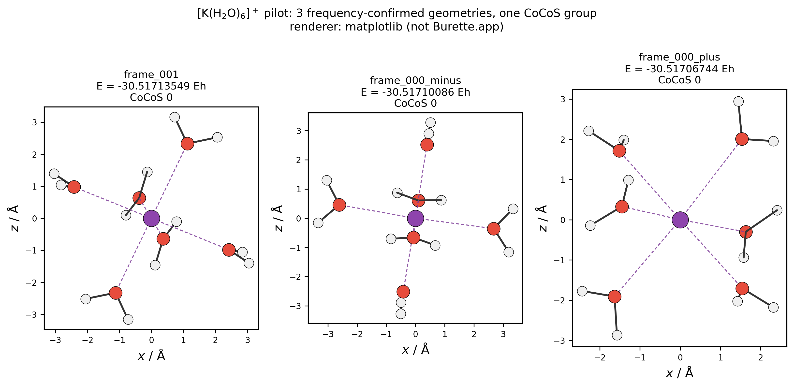
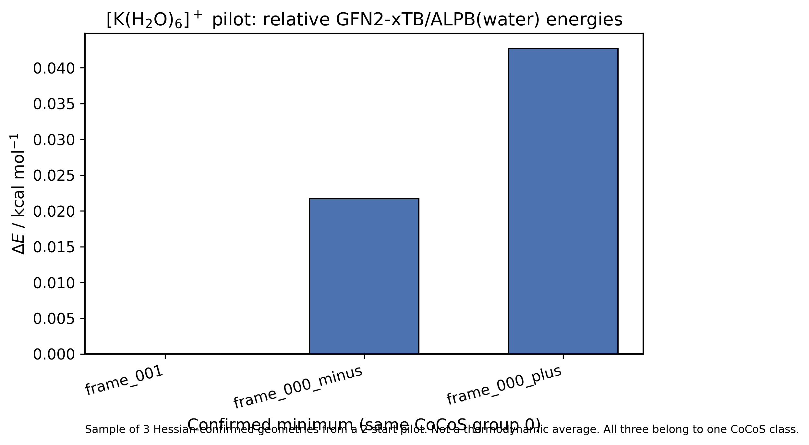

# waterel — Ion(H₂O)ₙ hydration workflow

GWH → unconstrained GFN2-xTB/ALPB(water) → Hessian / mode following → CoCoS (confirmed minima only) → MDAtomLocalEnvironment + Python first-shell descriptors → Burette scenes / xyzrender / Matplotlib → this repository.

This tree is the working kit. Production 100-start series are **not** launched while `CASE_STATUS.csv` has `ON_HOLD` / `NOT_ASSIGNED`. `DENIS_ASSIGNED=yes` is the only production bypass; `ALLOW_FULL_BATCH` is not.

## What is actually calculated

| System | Data | Notes |
|---|---|---|
| K⁺(H₂O)₆ **pilot** | 2 GWH starts, 3 Hessian-confirmed minima, **1 CoCoS group** | `results/K_06/pilot_2/` (original, not rewritten) and `results/K/6/` |
| Li⁺, Na⁺, Rb⁺ production | none in this kit | Na verbally claimed; Rb in progress elsewhere; no CASE_STATUS rows |
| F⁻ | none | code accepts `--chrg -1`; no packing; no QC |
| K⁺(H₂O)₄,₅ packings | Sloane dim-3, R=3.04 Å | `NOT_ASSIGNED`; author K_06–14 packings unchanged |
| Cl⁻(H₂O)₄–₁₄, Br⁻(H₂O)₄–₁₄ | packings only | Sloane directions; R(Cl–O)=3.21 Å, R(Br–O)=3.36 Å from mendeleev; **NOT_ASSIGNED**; no GWH `--Opt` / xTB |

Final unique XYZ: [`results/K/6/final/unique_representatives.xyz`](results/K/6/final/unique_representatives.xyz)  
Descriptors: [`results/K/6/final/descriptors.csv`](results/K/6/final/descriptors.csv)  
Figure index: [`figures/FIGURE_INDEX.md`](figures/FIGURE_INDEX.md)  
Results index: [`RESULTS_INDEX.md`](RESULTS_INDEX.md)

### Example images (Matplotlib; not Burette.app)





Burette.app is macOS-only. Scenes for a Mac workspace are in `figures/burette/scenes/<id>/original.xyz`. Headless exports, if xyzrender is installed, are under `figures/burette/` and labeled **xyzrender**, never as Burette.app screenshots.

## Reproduce (WSL Ubuntu)

```bash
source ./env_xtb.sh          # Intel-static xTB; do not use /usr/bin/xtb for --opt
python3 -m pytest tests -q
python3 workflow.py status
python3 workflow.py process-existing   # descriptors + figures from the existing K6 pilot
```

Production 100-start K₆ (blocked unless Denis assigns):

```bash
# do not run while CASE_STATUS K_06 is ON_HOLD
# DENIS_ASSIGNED=yes ./RUN_ONE_APPROVED_CASE.sh K_06
```

xTB command (cations): `xtb input.xyz --gfn 2 --chrg 1 --alpb water --opt tight`  
Anions, when assigned: `--chrg -1`.

## Pinned third-party software

See [`PINNED_VERSIONS.md`](PINNED_VERSIONS.md) and [`PINNED_VERSIONS.json`](PINNED_VERSIONS.json).

| Tool | Pin |
|---|---|
| GWH | `7411811374b6422a15f23d6d86a47f2145f8ac47` (`from_euler('zyz')`; SciPy lowercase = extrinsic — **not changed**) |
| CoCoS | `47f6680da2eee90d9b18536fd94d2bc8f6d05aad` |
| MDAtomLocalEnvironment | `3c43de70abef1f64fb31a2fe2693e4e73b88083c` |
| xTB | v6.7.1 source `26b28010e805f7d1aeeef39813feb473e69cc4be`; runtime Intel-static 6.7.1 (`edcfbbe`) |
| Burette | https://github.com/SergeiNikolenko/Burette — macOS app; scenes stored, app not run here |
| xyzrender | optional CLI; Burette’s documented XYZ fallback |

## CN and publication filters

The K first-shell cutoff **3.20 Å** is an engineering default (`BLOCKING_UNCONFIRMED`). All three K₆ confirmed minima have six K–O distances below 2.71 Å, so CN = 6 at that cut. Do not drop a CoCoS group from one representative until the other frequency-confirmed members are checked. Unweighted means over structures are **not** thermodynamic averages.

## Tests

GitHub Actions runs `pytest tests` on Ubuntu (no xTB). Locally the same suite covers xTB log parsing, Hessians, CoCoS confirmed-only logic, anion charge, shell descriptors, and visualizer XYZ integrity.

## Repository contents

Public `waterel` is this kit after the 2026-11-01 audit (`CLEANUP_REPORT.md`, `SHA256SUMS.txt`). Session-only Git/WSL helpers were archived locally and are not in Git. Vendor checkouts, `cases/`, `pilots/`, and previous cleanup backups stay on the Linux workstation (gitignored). No new quantum-chemical jobs were launched for the cleanup.
